<a href="https://jotav.me">
  <picture>
    <source media="(prefers-color-scheme: dark)" srcset="./cards/hero-dark.svg">
    
  </picture>
</a>

<a href="https://github.com/josevictoremiliano"><picture><source media="(prefers-color-scheme: dark)" srcset="./cards/tile-contrib-dark.svg"></picture></a>
<a href="https://github.com/josevictoremiliano"><picture><source media="(prefers-color-scheme: dark)" srcset="./cards/tile-streak-dark.svg"></picture></a>
<a href="https://github.com/josevictoremiliano?tab=repositories"><picture><source media="(prefers-color-scheme: dark)" srcset="./cards/tile-repos-dark.svg"></picture></a>

<a href="https://jotav.me/#expertise">
  <picture>
    <source media="(prefers-color-scheme: dark)" srcset="./cards/stack-dark.svg">
    
  </picture>
</a>

<a href="https://github.com/josevictoremiliano">
  <picture>
    <source media="(prefers-color-scheme: dark)" srcset="./cards/activity-dark.svg">
    
  </picture>
</a>

<a href="https://github.com/josevictoremiliano/larafim"><picture><source media="(prefers-color-scheme: dark)" srcset="./cards/repo-larafim-dark.svg"></picture></a>
<a href="https://screvo.painel.jotav.me/"><picture><source media="(prefers-color-scheme: dark)" srcset="./cards/repo-screvo-dark.svg"></picture></a>

  <a href="https://jotav.me"><b>jotav.me</b></a> ·
  <a href="https://www.linkedin.com/in/jose-victor-83334073/">LinkedIn</a> ·
  <a href="https://www.instagram.com/j.victorms/">Instagram</a> ·
  <a href="https://twitter.com/j_victorms">X / Twitter</a> ·
  <a href="mailto:contato@jotav.me">contato@jotav.me</a>

